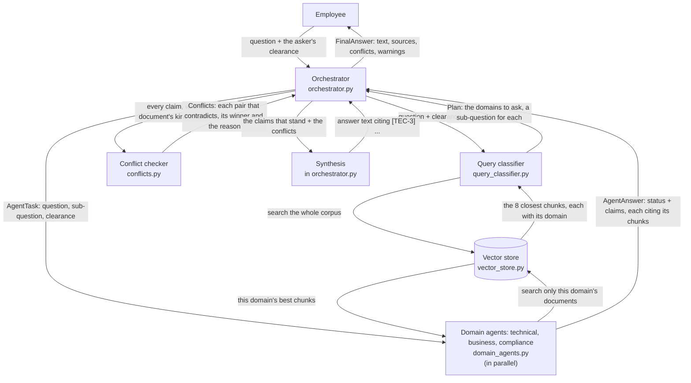
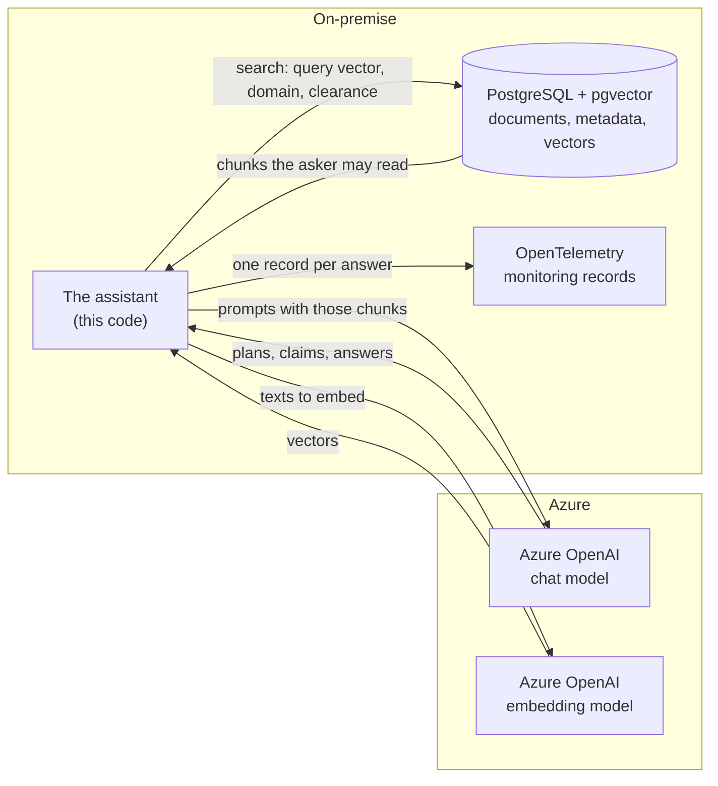

# Architecture

This page is the map of the system: its parts, what each part sends to
the next, and where each part lives in the code. The
[README](../README.md) tells the story with a real answer;
[decisions.md](decisions.md) gives the reason for every choice and the
options it rejected.

## The system on one picture

One question goes down the page. Each arrow says what is sent along it.



The orchestrator is the hub. The agents never talk to each other or to
the classifier; every message goes through the orchestrator.

## Who does what

Each part uses a model only to read or write text. Everything that must be
checkable later is decided by code.

| Part | A model... | Code... |
|---|---|---|
| Query classifier | picks the domains and writes a sub-question for each, from the question and the 8 closest chunks | runs the search first, so the model routes from what the documents hold |
| Domain agent | writes short claims from the chunks it was given | keeps the first 8 chunks (up to 10 while similarity is at least 0.4), refuses a claim that cites a chunk it was not given, builds every citation |
| Conflict checker | finds pairs of claims that contradict; for two documents of the same kind, a judge marks which other documents support each side | picks the winner: the stronger kind (policy, standard, guide, runbook), then the side with more supporting documents, else no winner |
| Synthesis | writes one answer citing document ids | checks every cited id, asks the model again if one was not given, writes the source list itself |
| Vector store | (none) | filters by clearance and superseded versions first, then ranks by meaning and by words, merged |

## Three ideas that shape the code

**1. Code coordinates, models read text.** `Orchestrator.answer` is plain
Python: classify, ask the agents in parallel, check conflicts, synthesise,
list the sources, as numbered steps. The order of the steps never depends
on a model. Only the route (which domains) is the model's decision, and it
is a value in the plan, not a jump in the code.

**2. The parts talk in messages.** Every message is a frozen Pydantic model
in `messages.py`, so whoever receives it cannot change it:

| Message | From, to | Carries |
|---|---|---|
| `Plan` | classifier to orchestrator | one `SubQuery` per domain: domain, text, whether old versions count |
| `AgentTask` | orchestrator to an agent | the question, its sub-question, the asker's clearance |
| `AgentAnswer` | an agent to orchestrator | status (answered, nothing relevant, failed), claims, the chunk ids it read |
| `Claim` | inside an answer | one statement and the `Citation`s it rests on |
| `Conflict` | conflict checker to orchestrator | two claims, the decision, both scores, the reason |
| `FinalAnswer` | orchestrator to the caller | the text, sources, conflicts, warnings, and the plan and agent answers it came from |

**3. Models come from outside.** `Assistant` in `app.py` is the one place
that reads `.env` and builds the language model and the embedding model.
Every part below receives them as parameters. So one setting switches the
whole system between the offline stand-in (no key: answers by template),
Anthropic and Azure OpenAI, and the tests pass the offline model without
patching anything.

## When something breaks

A failing step makes the answer poorer, not absent. The answer says what
was skipped in `warnings`.

| What fails | What the answer does |
|---|---|
| the question has no word | refused with `ValueError` before any search |
| the classifier | every domain is asked the whole question |
| one agent | the other agents' claims are used; that agent's status is `failed` |
| no chunk is close enough | the agent reports `nothing relevant` |
| the conflict detector | no conflict check |
| the judge, for one conflict | that conflict has no winner |
| the synthesis | the claims are listed as the agents wrote them, with their sources |

Every model call has a timeout.

## How the code is laid out

Read it top-down. Each file answers one question, opens with a map of its
flow, and calls only the files below it.

```
app.py, __main__.py   How is the system built, and asked from the command line?
  orchestrator.py     START HERE: what happens when a question arrives?
    query_classifier.py   Which domains, with which sub-question?
    domain_agents.py      How does one agent answer from its documents?
    conflicts.py          Which claims contradict, and who wins?
      learning.py         What does feedback change in the next search?
      vector_store.py     How are chunks filtered and ranked?
        ingestion.py      How are documents read and cut into chunks?

used by all:  messages.py (the protocol), config.py (settings, model
              factories), offline_model.py (the stand-in without a key),
              monitoring.py (a record of every answer)
```

The method that runs a file's steps carries an "Example" comment under
each step: one real question from the gold set, what goes in and what
comes out. An eval test checks those values, so a comment that goes stale
fails the tests.

## In production

The demo runs in one process with the index in memory. The target is the
bank's setting: the models on Azure OpenAI, everything else on-premise.



What is built and what is not:

- **Azure OpenAI:** `LLM_PROVIDER=azure` and `EMBEDDING_PROVIDER=azure`
  build both models; the configuration is unit-tested, but the path has
  not been run against Azure.
- **pgvector:** not implemented. It would be one more class behind the
  same `VectorStore` interface the agents use (`add`, `search`, `model`).
  It would also store the embedding model next to the vectors and refuse a
  query embedded by another model.
- **OpenTelemetry:** not wired. `monitoring.py` keeps the same records in
  memory for the notebook; PydanticAI sends its model calls (durations,
  tokens) to OpenTelemetry once `Agent.instrument_all()` is called.
- **Confidential documents:** with confidential clearance their text goes
  to the cloud model too. The bank's own rule in the corpus (CMP-2) allows
  that only with pseudonymisation and a sign-off; the README lists this
  under the assumptions.
