# The Self-Service Paradox

How one workflow platform can serve business users who want drag and drop
and power users who want code, without becoming two systems.

## The story in short

The assignment asks for a platform on which employees "build their own
workflows using microservices". A workflow is an automated task made of
steps that run in order; each step is one action that uses a service the
bank already has. Business users want to build workflows by clicking,
power users by writing code, and both must work on one platform. The
platform has two halves: the **definition** of each workflow, which says
what should happen, and the **runner**, which reads definitions and makes
it happen. Here is how both work, followed through one workflow as it
grows.

### Week 1: a clerk builds it with a wizard

A clerk in Finance wants the team lead to get the list of overdue invoices
every Monday morning, without anyone compiling it by hand. A workflow can
start on a schedule, like a cron job, or on an event, such as a customer
submitting a form; this one starts on a schedule. The clerk opens the
template "weekly overdue invoices" and answers three questions in
a form, the wizard <em>(recommended: forms built by <a href="https://github.com/rjsf-team/react-jsonschema-form">react-jsonschema-form</a>)</em>: which department, who gets the list, and when. The
answers fill the blanks of the template, and the platform stores the
result as the workflow's **definition** <em>(recommended: <a href="https://github.com/open-workflow-specification/specification">Open Workflow specification</a> in YAML)</em>, a short description of its steps:

```text
Workflow:  Weekly overdue invoices                      version 1
When:      every Monday at 08:00                    (trigger: schedule)
Step 1:    find overdue invoices of Finance Sofia   (ready block: invoices service)
Step 2:    mail the list to the team lead           (ready block: mail service)
```

This card is a slightly simplified view of the definition; the real one,
in a standard format, is shown in the details below. The words in brackets
say what kind each step is. A **ready block** is an action that a developer
prepared once for everyone, such as "find invoices" or "send mail"; the
clerk never sees how it talks to the bank's systems. Other kinds of steps
appear as the workflow grows.

### Monday, 08:00: the platform runs it

The definition is only a description; it does nothing by itself. One
program in the platform, the **interpreter** <em>(recommended: built in-house on <a href="https://github.com/dbos-inc/dbos-transact-py">DBOS Transact</a> and Postgres, <a href="https://github.com/temporalio/temporal">Temporal</a> as the fallback)</em>, understands the definition
format and runs any workflow written in it. It is written once by the
platform team and does not change when a workflow changes. On Monday at
08:00 it does this:

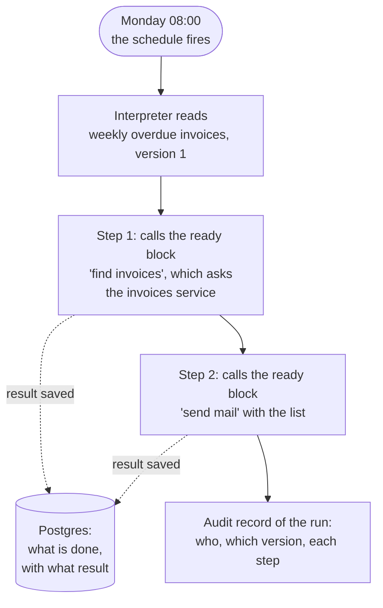

The real work is done by the blocks, which talk to the bank's services;
the interpreter only follows the definition and calls them in order. After
each step it saves the result, so if the server restarts between step 1
and step 2, the run continues with step 2 and does not search the invoices
again. Because every workflow, whoever built it and however, is in the same
format, this one runner serves them all.

### How it is built, at a glance

Five pieces, each with one idea. The links lead to the details.

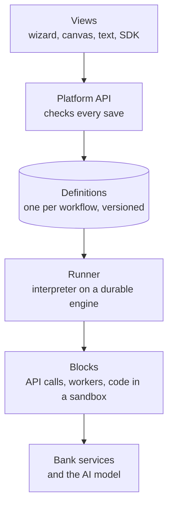

| Piece | The idea | Built with | Details |
|---|---|---|---|
| Definition | one description per workflow, every change a new version | [Open Workflow](https://github.com/open-workflow-specification/specification) YAML | [the definition](#the-definition-and-who-edits-it) |
| Views | windows onto the same definition | [React Flow](https://github.com/xyflow/xyflow), [forms from JSON Schema](https://github.com/rjsf-team/react-jsonschema-form), [Monaco](https://github.com/microsoft/monaco-editor), an SDK | [interface design](#interface-design) |
| Checks | the platform checks every save, not people | [Open Policy Agent](https://github.com/open-policy-agent/opa), [CEL](https://github.com/cel-expr/cel-spec) | [from save to production](#from-save-to-production), [data rules](#how-the-data-rules-work) |
| Runner | one program runs every workflow and survives restarts | in-house interpreter on [DBOS Transact](https://github.com/dbos-inc/dbos-transact-py) and Postgres | [the runner](#the-runner-the-interpreter-on-a-durable-engine) |
| Blocks | where the work happens, in any language | API descriptions, workers, a sandbox | [interface connections](#interface-connections), [extension mechanisms](#extension-mechanisms) |

### Month 1: a colleague extends it on the canvas

Large debts should go to the CFO. The wizard has no question for that, so
an experienced colleague opens the same workflow on the **canvas** <em>(recommended: <a href="https://github.com/xyflow/xyflow">React Flow</a>)</em>, an
editor of boxes and arrows, and adds a branch <em>(recommended: conditions in <a href="https://github.com/cel-expr/cel-spec">CEL</a>)</em>:

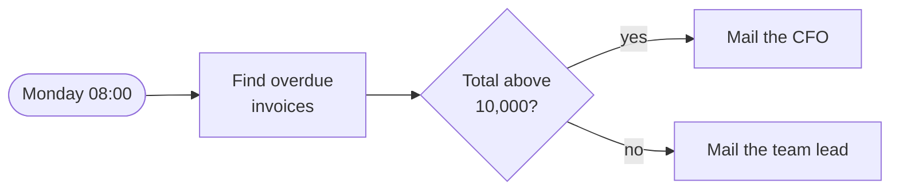

```text
Workflow:  Weekly overdue invoices                      version 2
When:      every Monday at 08:00                    (trigger: schedule)
Step 1:    find overdue invoices of Finance Sofia   (ready block: invoices service)
Step 2:    if the total is above 10,000             (built-in step: branch)    NEW
             yes: mail the list to the CFO          (ready block: mail service)
             no:  mail the list to the team lead    (ready block: mail service)
```

The canvas is not a second tool: it is another window onto the same
definition, which now has version 2. Nothing was rebuilt, and nobody had
to ask IT. This is the answer to the assignment's conflict: simple and
powerful are levels of one platform, not two systems.

### Month 2: a developer adds code

Finance wants a late fee on every invoice, worked out by a calculation
with eight conditions. Boxes and arrows cannot express that, so a developer
adds one **code step** <em>(recommended: runs in a container with limits)</em>:

```text
Workflow:  Weekly overdue invoices                      version 3
When:      every Monday at 08:00                    (trigger: schedule)
Step 1:    find overdue invoices of Finance Sofia   (ready block: invoices service)
Step 2:    calculate late fees                      (code step, by finance developers)    NEW
             takes: the invoices
             gives back: the fees
Step 3:    if the total is above 10,000             (built-in step: branch)
             yes: mail the list to the CFO          (ready block: mail service)
             no:  mail the list to the team lead    (ready block: mail service)
```

The developer writes the calculation as an ordinary Python function in
their own repository, with tests, and adds it to the workflow through the
platform's SDK <em>(recommended: built in-house over the <a href="https://github.com/open-workflow-specification/sdk-python">Open Workflow SDKs</a>)</em>, a library that loads the latest version of the definition,
changes it and saves a new version:

```python
# fees.py, in the developer's own repository, tested like any other code
def late_fees(invoices):
    ...                                    # the eight conditions

# add the step to the workflow (an illustrative SDK: the platform's own, names not final)
workflow = Workflow.load("weekly-overdue-invoices")      # version 2, as the clerk left it
workflow.insert_after("findInvoices", code_step(
    "calculateLateFees", late_fees, takes="invoices", gives_back="fees"))
workflow.save()                                          # version 3; code, so a second person reviews it
```

The same change could be made in the platform's text editor <em>(recommended: <a href="https://github.com/microsoft/monaco-editor">Monaco</a> with <a href="https://github.com/remcohaszing/monaco-yaml">monaco-yaml</a>)</em> or sent to
its API from any language; the SDK is the convenient way. On the canvas the
clerk sees a closed box with the step's name,
what it takes and what it gives back, and keeps editing everything around
it: the schedule, the recipients, the order of the other steps. The box is
the boundary: the business user works with the boxes, the developer has
full freedom inside them.

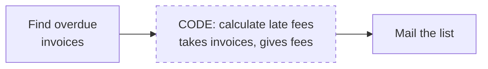

### Every save: the platform checks

Each save creates a new version, and the platform checks it <em>(recommended: policies in <a href="https://github.com/open-policy-agent/opa">Open Policy Agent</a>)</em> before it can
run. Version 3 contains code, so a second person had to approve it;
versions 1 and 2 went live at once. When someone tries to send a
customer's file to the AI model in the cloud, the canvas refuses the
connection and suggests a step that masks names and account numbers first.
Business users only see blocks that were checked. The checks live in the
platform, not in people's memory.

### What already exists, and what comes next

The bank's existing services become ready blocks, and its old scripts
enter the platform as single blocks first, with an owner and an audit
trail, to be taken apart later. A workflow that is already running
finishes on the version it started with. And a user can describe a new
workflow in one sentence, let AI draft the definition, and check the draft
on the canvas before it runs.

The rest of the document goes into the details: how a definition is
written, who can change what, how the runner works, the words used, seven
use cases from the bank, why this design, and then the four sections the
assignment asks for.

## The definition, and who edits it

The definition cards in the story are written in a standard format,
YAML. This is version 1 of the weekly overdue invoices workflow:

```yaml
document:                          # what this workflow is
  name: weekly-overdue-invoices
  version: '1.0.0'                 # every saved change is a new version
  metadata: { owner: finance-ops, template: weekly-overdue-invoices }
schedule: { cron: '0 8 * * 1' }    # every Monday at 08:00
do:                                # the steps, in order
  - findInvoices:
      call: list-invoices:2.0.0@bank-catalog   # a ready block from the catalog
      with: { status: overdue }
  - notify:
      call: send-mail:1.3.0@bank-catalog
      with:
        to: ${ .recipient }                    # the wizard filled this blank
        body: ${ .findInvoices.list }          # the output of step one
```

### Who does what

A month later Finance wants a late fee added to each overdue invoice, by a
calculation with eight conditions that boxes cannot express. A developer adds one
code step. Here is the same workflow, seen by both:

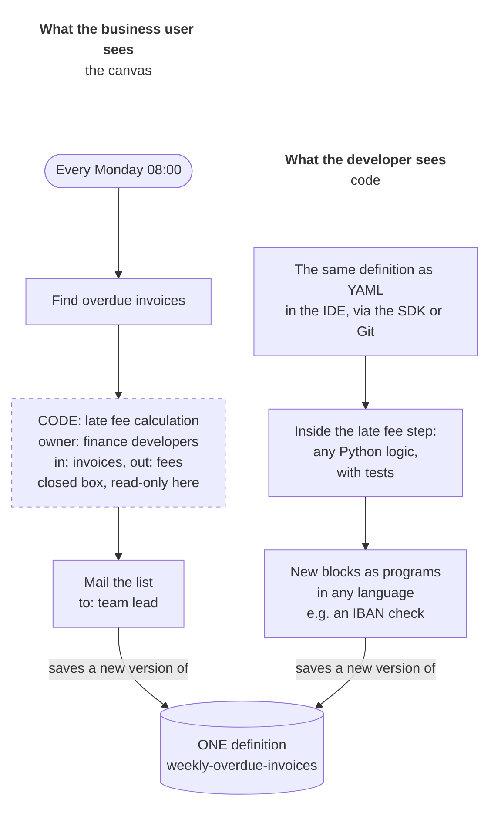

In the definition, the developer's step is just one more step, with its
code inside:

```yaml
  - lateFee:                       # a closed box on the canvas
      run:
        script:
          language: python
          code: |
            fees = [late_fee(invoice) for invoice in invoices]
      metadata: { owner: finance-developers, input: invoices, output: fees }
```

| | Business user | Developer |
|---|---|---|
| Works in | wizard, canvas | text view, SDK in any language, Git, API |
| Changes | order of steps, recipients, schedule, conditions; adds certified blocks | everything, including the code inside steps and new blocks |
| Sees the code step as | a closed box: name, input, output, owner | Python in their own editor, with tests |
| Cannot | edit inside a code box | skip the rules: every save is checked |

Why the two do not get in each other's way:

1. **The code lives inside one step**, and the step declares its input and
   output. The canvas works only with that contract, so it never has to
   understand the code, and moving the box or changing the recipient around
   it does not touch it.
2. **Both edit the same definition**, and every save is a new version made
   from the latest one. A save made from an older version is refused, as
   with a conflict in Git, so nobody silently overwrites the other.
3. **The developer's full coding flexibility** is in three places, none of
   which the canvas has to draw: inside a code step (any Python or
   JavaScript, or any language in a container), in new blocks (programs in
   any language) and in the definition itself (edited as text or through an
   SDK).

## The words, with examples

| Word | What it is | Example |
|---|---|---|
| Workflow | an automated task: steps that run in order | every Monday, remind the team of overdue invoices |
| Definition | the one file that describes a workflow's steps | the YAML below |
| Step | one item of a workflow | find the overdue invoices |
| Block | a ready action from a shared catalog that a step calls | send mail, find customer |
| Template | a workflow with blanks for others to fill | weekly overdue invoices: which department, who, which day |
| View | a way to see and edit a definition | wizard, canvas, text, SDK |
| Wizard | a form that fills the blanks of a template | three questions, then done |
| Canvas | an editor of boxes and arrows | drag in a 'send mail' box |
| Local code | a few lines of code inside one workflow | a fee calculation with eight conditions |
| Engine | the program that runs workflows and logs every run | |

## Seven use cases, one platform

The assignment asks for "practical and implementable solutions", so here is
where real requests go. Each branch is one way into the same platform.

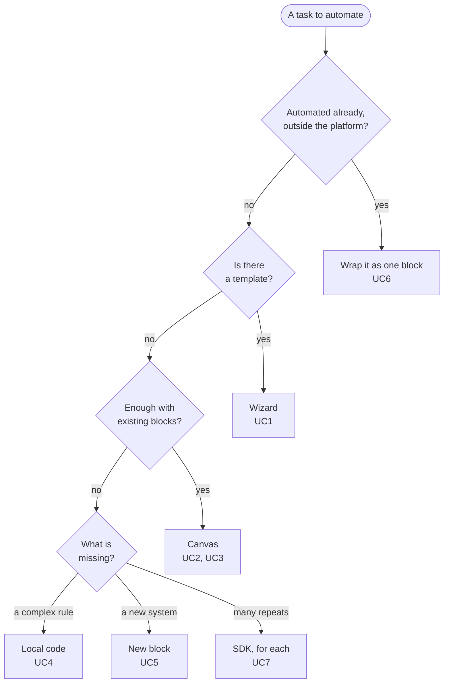

| # | Use case | Who | Path | Second person reviews? |
|---|---|---|---|---|
| UC1 | Weekly list of overdue invoices | finance clerk | template, wizard | no |
| UC2 | Check a customer's new address | operations analyst | canvas, CRM block, human approval | yes, customer data |
| UC3 | Summarise complaints with AI | customer care lead | canvas, masking step, AI block | yes, first AI step |
| UC4 | Fee calculation with 8 conditions | power user | local code in a sandbox | yes, local code |
| UC5 | Old screening system without an API | developers | new worker block (a robot that drives the screens) | yes, new system |
| UC6 | Nightly payment reconciliation script | its owner | wrap as one block, split later | yes, moves money |
| UC7 | Same report for each of 12 branches | power user | SDK, one for-each step | no |

Two of these show the rules at work. In UC3 the canvas refuses to connect
"find customer" to "summarise with AI" until a masking step sits between
them, because customer data may not reach the cloud model unmasked. In UC1
nobody waits: internal data, certified blocks, no code, so the workflow
goes live after the automatic checks.

## Why this design

How I got from the assignment to the solution above: the problem, what
"one platform" has to mean, where the microservices fit, and the
principles the design follows.

### The problem: a cliff between simple and powerful

Business users want to click; power users want to code. Give everyone one
simple tool and the power users hit its limits; give everyone one powerful
tool and the business users give up; give each group its own tool and the
two cannot work on the same thing. Lea Verou has a name for what goes wrong
in the third case, a usability cliff: "a small increase in use case
complexity requires a large increase in user effort".

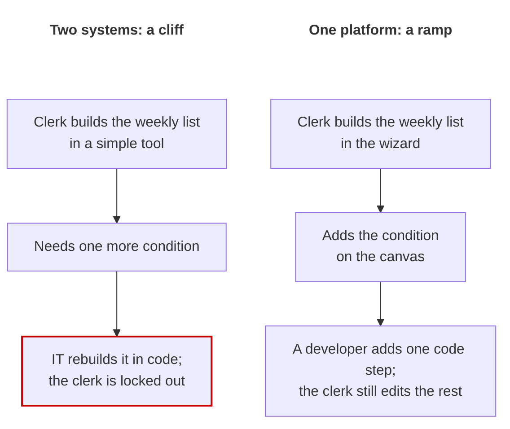

Everyone knows one tool that already solves this: a spreadsheet. One file
serves three people. A clerk types numbers into cells, an analyst writes
formulas over the same cells, a developer writes a macro that reads and
writes the same cells. Nobody leaves the file, and everyone sees the
others' work. The goal is the same for workflows: in Alan Kay's words,
"simple things should be simple, complex things should be possible", and,
as Verou adds, "the transition between the two should also be smooth."
### What "one platform" means

The assignment asks for a "single unified platform, not separate systems". That
sentence can be read two ways:

| | It looks like one | It is one underneath |
|---|---|---|
| What is shared | a login, a menu, a logo | what is stored and run, and the rules |
| Underneath | two systems | one |
| A wizard workflow can be continued in code | no | yes |
| Cliff | yes | no |

Only the second reading avoids the cliff, so it is the one I design for.
The platform holds many workflows; each workflow has one definition, and the wizard, the canvas and the code editor are windows onto
that definition. The windows differ; the thing behind them is the same.
### Where the microservices fit

The assignment says employees "build their own workflows using microservices".
The microservices already exist in the bank, each doing one job (read a
customer, send an email). The platform does not build them and does not
decide their scope; it puts them in order. A workflow is a list of steps,
and each step calls one capability. When a task needs a bit of two
services, that is two steps. When a task needs something no service does,
a developer adds a new building block, which is the high ceiling. I do not know which services the bank has, so the design assumes only that each
capability can be wrapped in a block with a clear contract: a name, inputs,
outputs and who may use it.
### Seven principles

| Principle | What it means here | Example | From |
|---|---|---|---|
| One definition, many views | every editor reads and writes the same definition | the clerk and the developer edit one file | AWS Step Functions |
| Escape hatch, not ejector seat | code enters as one step; the rest stays editable | one code box in an eight-step workflow | Anvil |
| A smooth ramp, and a way back | each level is one click from the next | "open on canvas", "view as text" | Kay, Resnick, Verou |
| Those who can do more make it safe for the others | developers build blocks once, business users reuse them | one "find customer" block with built-in permissions | Microsoft fusion teams |
| The safe way is the easy way | the platform enforces the rules, not people's memory | business users only see certified blocks | platform engineering, OWASP |
| Review grows with risk | small changes go live, risky ones get a second look | the weekly list goes live at once; an address change waits | Gartner |
| AI is one more way in | AI drafts the same definition; people review it | "every Monday, mail me the overdue invoices" becomes a draft | Power Automate, Anthropic |

## 1. Context

> [!TIP]
> I design for a bank with four hard constraints, and for the assignment's two kinds of users.

### The setting

I design for a bank, because the constraints make the trade-offs real:

1. It is regulated, so every run of every workflow is audited.
2. Some core systems are old and have no API.
3. Language models run in Azure; everything else runs on-premise.
4. Customer data must not leave the bank unprotected.

Conditions 3 and 4 are why this document spends time on data rules. In a
company without them that part would be much shorter.

### Who uses it

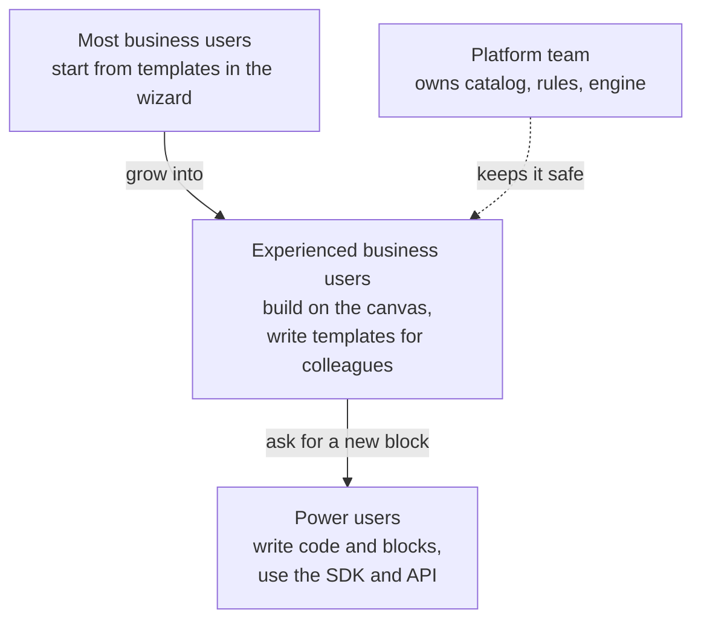

I keep the assignment's two roles. The assignment's business users already ask for
"drag-and-drop simplicity", which is the canvas, so the two roles cover all
the views. Business users differ in experience, not in role: the more
experienced ones (often called low-code champions) assemble workflows and
write templates for the others. The platform team is not a user role; it
owns the catalog, the rules and the engine.

## 2. Architecture Design

> [!TIP]
> Every view edits one stored definition, one interpreter runs it, and every step calls a block, never a bank system directly.

### Overall architecture

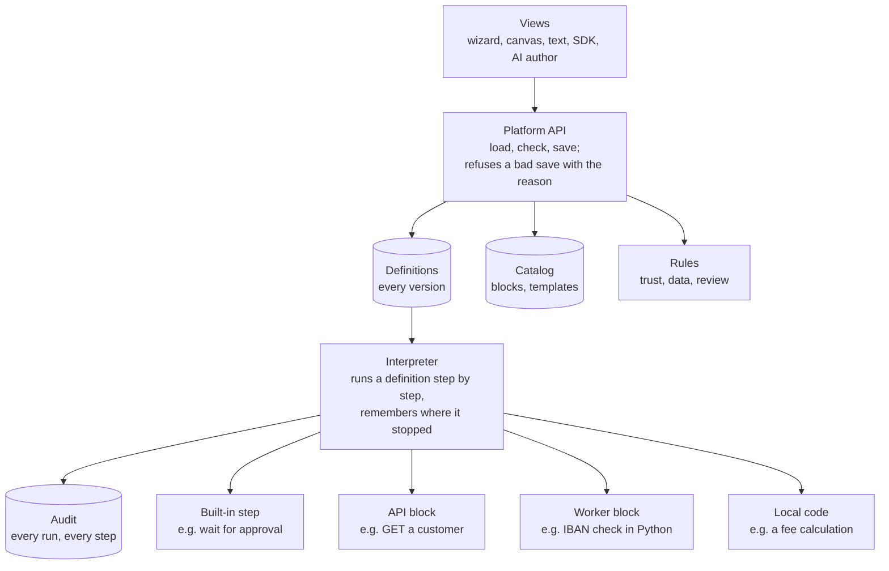

The boxes say what each part does. Two choices carry the design. Every
view goes through one API, so every check happens in one place, whichever
view made the change. And one interpreter, written once by the platform
team, runs every workflow; it sits on a durable execution library that
records each step in Postgres, so a run that waits two days for an approval,
or survives a crash, continues where it stopped.

### Interface connections

A step never calls a bank system directly; it calls a block from the
catalog. Most blocks wrap an API that already exists, so they are only a
description ("call `GET /customers/{id}` on the CRM") and the engine makes
the call. Where there is no API, or the logic is the team's own, the block
is a worker: a small program in any language that asks the engine for work.

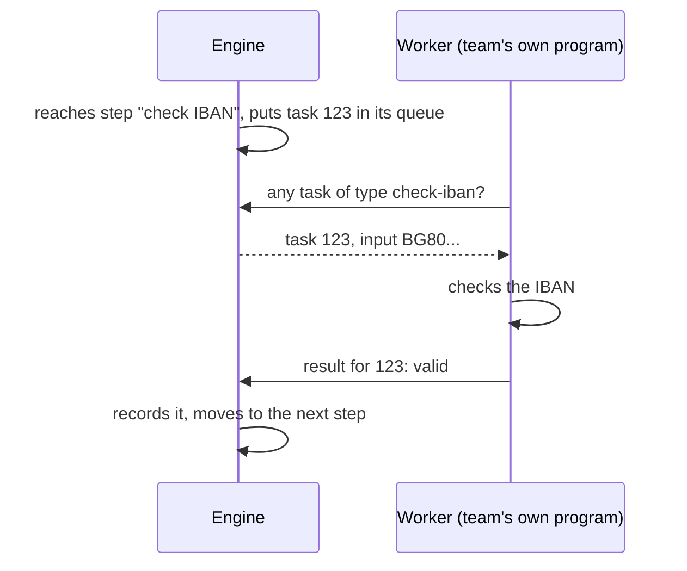

The engine never connects to the worker, so it needs no network path into
each team's machines, and a worker takes work only when it has capacity.
The robot in UC5, which drives the screens of a system without an API from
a Windows machine, is a worker of this kind. AI blocks (summarise, classify,
extract fields) call the model in Azure with a fixed input and a structured
output; the data rules in section 4 decide what may reach them.

### Progressive disclosure strategy

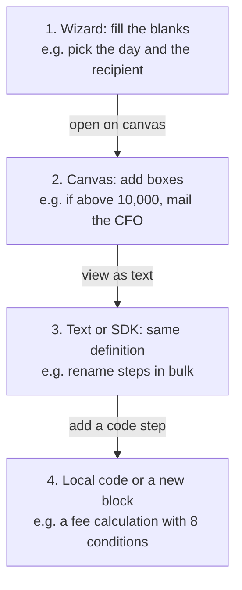

Each level is one action away from the next, and the way back stays open.
Two rules keep the path smooth. First, a view shows what it cannot edit
instead of hiding or dropping it: local code is a closed box on the canvas
with its name, input, output and owner, and the canvas can move, connect or
delete the box but not change what is inside. Second, a workflow that no
longer matches its template (someone added a step on the canvas) is edited
on the canvas from then on, and the wizard says so instead of showing half
of it. The template, and the other workflows made from it, are not
affected.

## 3. User Experience Strategy

> [!TIP]
> A user climbs from the wizard to the canvas to code one step at a time, and the workflow never moves to another tool.

### Transitions between capabilities

[The story](#the-story-in-short) follows one workflow through every level:
the wizard in week 1, the canvas in month 1, a code step in month 2, and the
clerk still editing around the code box afterwards. The rules that keep
each step up and back smooth are in
[progressive disclosure strategy](#progressive-disclosure-strategy). One
more matters when two people work on the same workflow: each editor starts
from the latest version, and a save made from an older one is refused
("changed since you loaded it; load again"), as with a conflict in Git.

### Interface design

| View | Who | What it gives |
|---|---|---|
| Wizard | business users | the blanks of a template as a form |
| Canvas | business users | boxes and arrows, a palette of blocks |
| Text view | power users | the definition with autocomplete |
| SDK | power users | the definition as objects in their language |
| AI author | everyone | a draft from a sentence |

The input of every block is described with JSON Schema, so the wizard's
forms are generated, not written by hand. The canvas palette shows only
what a user may use (business users see certified blocks), and errors appear
where they happen, before saving. The AI author turns "every Monday collect
overdue invoices and send the list to my manager" into a draft of three
steps, which is checked, shown on the canvas and published the normal way.
It never goes straight to production.

### Onboarding pathways

Business users start from a gallery of certified templates and from the AI
author, and the champions in each department help them across to the
canvas. Power users start from the SDK documentation and a starter
repository for a block (manifest, worker, tests); a new block starts at the
experimental level, so a team can try it without waiting for anyone. Owners
of existing automations start by wrapping them (section 5), which gives them
audit and alerts in the first week.

## 4. Technical Implementation

> [!TIP]
> Small, replaceable parts plus three pieces built in-house: the interpreter, the catalog and the rules.

### Key components: ready-made or built in-house

I propose assembling the platform from small, open-source parts instead of
adopting a complete product. The controls this bank needs most (trust
levels, data classes, review by risk) are missing from the free editions of
the complete platforms I looked at ([Kestra](https://github.com/kestra-io/kestra),
[Camunda 8](https://github.com/camunda/camunda)) or are in their paid
editions, so the platform team builds them either way, and it is better to
build them over parts that can be replaced one at a time.

| Part | Ready-made | What it does | Licence |
|---|---|---|---|
| Format | [Open Workflow specification](https://github.com/open-workflow-specification/specification) | an open YAML format for workflows, with a JSON Schema and SDKs in several languages | Apache 2.0 |
| Engine | [DBOS Transact](https://github.com/dbos-inc/dbos-transact-py) | a Python library that saves each finished step in Postgres, so a workflow resumes after a crash (next section) | MIT |
| Canvas | [React Flow](https://github.com/xyflow/xyflow) | a library for editors of boxes and arrows in the browser | MIT |
| Wizard | [react-jsonschema-form](https://github.com/rjsf-team/react-jsonschema-form) | builds a web form from a JSON Schema, so each block's input becomes a form | Apache 2.0 |
| Text view | [Monaco](https://github.com/microsoft/monaco-editor) with [monaco-yaml](https://github.com/remcohaszing/monaco-yaml) | the editor of VS Code in the browser, with autocomplete from the schema | MIT |
| Conditions | [CEL](https://github.com/cel-expr/cel-spec) ([cel-python](https://github.com/cloud-custodian/cel-python)) | a small, safe language for conditions such as `total > 10000`; it cannot run arbitrary code | Apache 2.0 |
| Checks | [Open Policy Agent](https://github.com/open-policy-agent/opa) | evaluates the platform's rules (who may use which block, where data may go) kept apart from the code | Apache 2.0 |
| Sandbox | containers with limits on time and memory | runs local code isolated from everything else | |

Built in-house: the **interpreter** (it reads a definition and runs it,
next section), the **catalog** (blocks and templates with owners, versions
and trust levels), the **rules themselves**, and the glue between the
parts: the palette and closed boxes on the canvas, the template blanks in
the wizard, the platform's own fields in the definition.

### The runner: the interpreter on a durable engine

A workflow can run for days: version 3 of the weekly overdue invoices waits
for nobody, but the address change in UC2 waits for a person to approve.
Servers restart in the meantime. The engine must therefore remember, for
every run, which steps are already done, and continue from there after a
restart instead of starting again and sending the same mail twice. This is
called durable execution.

DBOS Transact gives exactly that as a library. A function marked as a
workflow calls functions marked as steps; DBOS writes the result of every
finished step into Postgres. After a crash the workflow is started again,
and every step that already has a saved result is skipped and returns that
result, so the run continues where it stopped. No separate server is
needed, only the Postgres database the bank already runs.

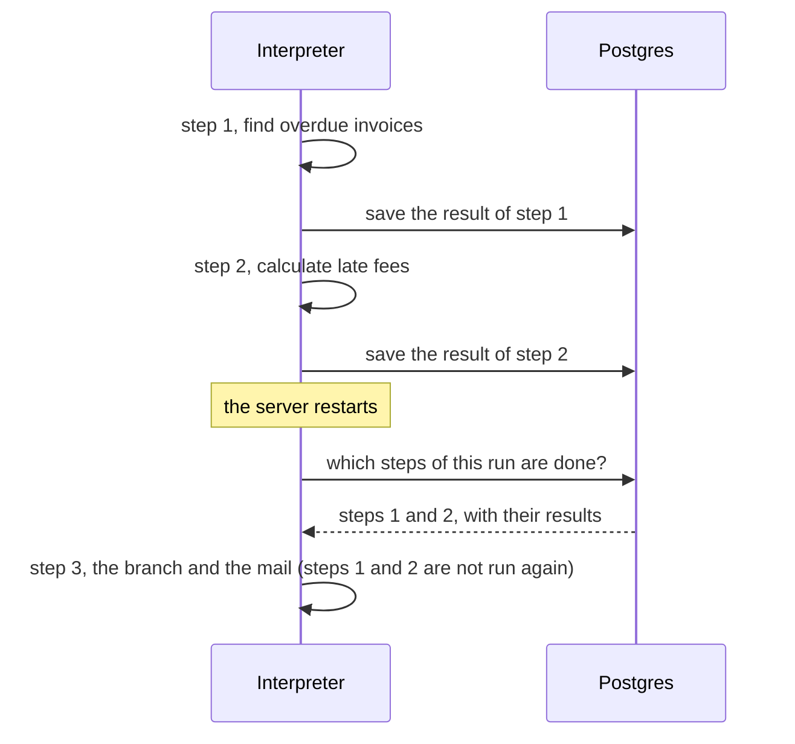

The interpreter is one such workflow function, written once by the
platform team. It does not know any particular workflow; it reads a
definition and runs its steps in order:

```python
@DBOS.workflow()
def run(definition, inputs):
    data = inputs
    for step in definition.steps:            # in the order of the definition
        data[step.id] = run_step(step, data)  # each call is a durable step
    return data

@DBOS.step()
def run_step(step, data):
    ...   # call a ready block, a worker or the sandbox, according to the step's kind
```

Waiting is a step too: a built-in "approval" step waits for a message from
the person who approves, and DBOS keeps the wait across restarts.
DBOS is young (its Python library was first released in August 2024),
which is a risk for a bank; [Temporal](https://github.com/temporalio/temporal),
public since 2019 and widely used, is the mature fallback. It does the same job as a
separate server and can replace DBOS at a larger scale; the definitions do
not change, because they never mention the engine (Temporal publishes an
[example of exactly this kind of interpreter](https://github.com/temporalio/samples-go/tree/main/dsl)).

### Data models

The workflow definition is a subset of the Open Workflow specification
(task kinds `do`, `call`, `switch`, `for`, `wait`, `run`, `try`). The
specification allows free `metadata` on the workflow and on every task,
which is where the platform's own fields go; other task kinds are refused on save.

An example is in [the definition, and who edits it](#the-definition-and-who-edits-it);
the document's `dsl` field pins the version of the specification (1.0.3).

<details>
<summary>The block manifest and the run record</summary>

A block manifest is the contract of a catalog block:

```yaml
block: find-customer
version: 2.1.0
owner: crm-team
trust: certified           # certified | team | experimental
kind: declarative          # declarative | worker
call: { method: GET, url: "https://crm.internal/customers/{id}" }
input:                     # JSON Schema; the wizard form is generated from it
  type: object
  required: [id]
  properties: { id: { type: string } }
output:
  type: object
  properties:
    name: { type: string }
    address: { type: string }
    iban: { type: string }
data:
  returns: confidential    # the class of the data it returns
  accepts: confidential    # the highest class it may receive
```

A run record is written for every run: workflow name and version, who or
what started it, start and end, status; and per step the block and its
version, input and output with customer data masked, duration and error.
Records are only appended, never changed, and are kept as long as the
bank's audit rules require.

</details>

### Extension mechanisms

| Kind of step | Lives | Example |
|---|---|---|
| Built-in | in the engine | wait, branch, approval, for each |
| Catalog block | in the catalog, shared | find customer, send mail |
| Local code | inside one workflow | the fee calculation in UC4 |

A new system arrives as a new catalog block: a manifest for an existing
API, or a manifest plus a worker. Local code is a short function inside one
workflow; it runs in its own container with limits on time and memory and
no direct network, reaches other systems only through catalog blocks, and
declares its input and output like a block, so the data rules apply to it.
The same code copied into several workflows is a sign it should become a
block. A new kind of built-in step is a change to the interpreter by the
platform team and appears in every view.

### How the data rules work

Every block declares the class of data it returns and the highest class it
accepts: public, internal or confidential. Customer data is confidential.
On save, the platform follows each output to the inputs that use it:

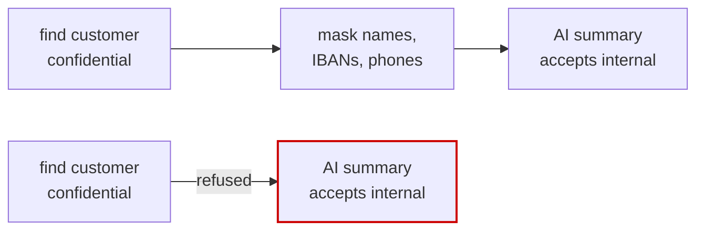

The second path is refused with the step names and a suggestion to add the
masking step, and the same check runs again at run time for the cases the
definition cannot show. The check follows the data, not the workflow, so a
workflow that reads the CRM may still send an email, as long as the
customer data does not end up in it.

## 5. Long-term Maintainability

> [!TIP]
> Nothing that works today breaks tomorrow: versions, wrapping old scripts, trust levels and review by risk.

### From save to production

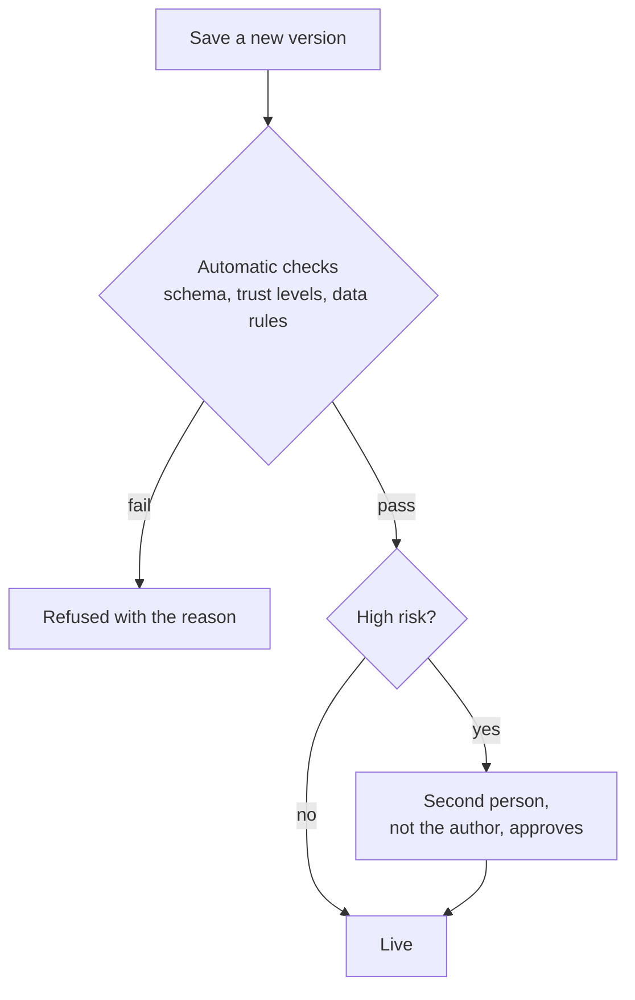

A change is high risk when it touches confidential data, adds the first AI
step to a workflow, adds a block for a new system, moves money, or adds
local code. Everything else goes live after the automatic checks, so most
changes never wait. Review sits where there is something to lose; reviewing
everything would push people back to building outside the platform.

### Platform evolution

A run finishes on the version it started with; new runs use the new
version, and a rollback makes the previous version active again. Blocks use
semantic versioning: a fix or a new optional field reaches every workflow,
while a change that breaks the contract is a new major version that
workflows adopt when their owners move. The catalog shows which workflows
use which version, so the owner of a block knows whom a change affects.

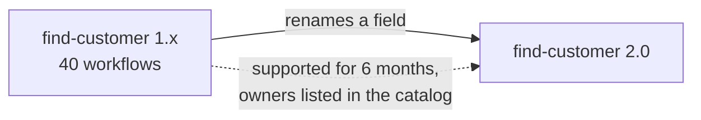

The format is a public specification, so the definitions do not depend on the interpreter or on the engine library; either can be replaced.

### Adding capabilities

New systems arrive as new blocks, without a platform release. New kinds of
steps come from the platform team. AI agents, where the model chooses which
blocks to call, are the next capability rather than part of the first
version: a predefined path keeps every run explainable for audit, and an
agent would use the same catalog under the same rules.

### Migration of existing automations

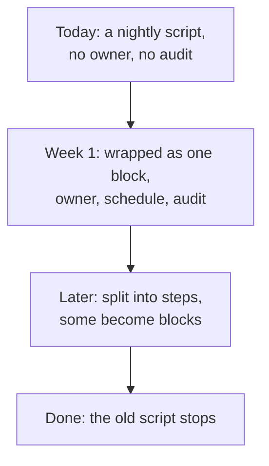

Existing automations are wrapped first and taken apart later (Martin
Fowler's strangler fig). Every
automation that exists today (scripts, scheduled jobs, RPA robots,
spreadsheet macros) enters as one worker block in a one-step workflow, with
its logic untouched. It gets an owner, a schedule, audit and alerts at
once. The riskiest ones are split into smaller steps first, and the old
script stops when the new steps replace it completely.

### Community and governance

| Trust level | Who may use it | In production |
|---|---|---|
| certified | everyone | yes |
| team | the author team | in its own workflows |
| experimental | the author team | never |

A block moves up a level after a platform team review (tests, owner,
documentation). Every workflow and block has an owner, and one without an
active owner is flagged. A template gallery, champions in each department,
and usage and failure numbers per block and template show the platform
team which blocks deserve promotion and which templates break.

## 6. Trade-offs

| Decision | I chose | I rejected, because |
|---|---|---|
| What a workflow is | a declarative definition | a program (Temporal style): the canvas could not edit it |
| Canvas and code | one stored definition; the SDK is a view | code in Git as a second source: business users locked out |
| Format | Open Workflow subset | a new format: the schema and SDKs would have to be written; BPMN: XML, its own editor |
| Platform | small parts plus in-house code | Kestra or Camunda: heavy, key controls paid |
| Blocks | API description or worker | plugins inside the platform: one language, one faulty block brings all down |
| Custom code | local code in a sandbox | catalog blocks only: ten lines would need a whole block |
| Data rules | along the data path | groups of blocks: a CRM workflow could send no email at all |
| Review | by risk | always: people bypass the platform |
| AI | author and blocks | agents now: the path is decided at run time, hard to audit |
| Migration | wrap, then take apart | rewrite from zero: months without audit |
| Roles | the assignment's two | a third role: covered by levels of experience |

What the design gives up. A power user cannot keep a workflow as a program with
their own abstractions; whatever the format cannot express is lost after
the first save. The interpreter and the glue between the parts are the platform team's to maintain. The format is wordier than one designed for this platform alone, and the
platform must follow its versions. And the sandbox for local code is one more thing to
run.

## 7. Assumptions and questions I would ask the business

| Question | What I assumed | Alternative considered |
|---|---|---|
| Which automations exist today, and who owns them? | scripts, scheduled jobs, RPA robots, macros | start clean with new workflows only |
| Which classes of data does the bank use? | public, internal, confidential | a separate class for personal data |
| What makes a change high risk? | confidential data, a first AI step, a new system, money, local code | review of every release |
| May business users publish low-risk workflows alone? | yes, after automatic checks | IT approves every release |
| May masked customer data reach the cloud model? | yes, once the data protection office signs off the use case | never |
| Which languages do the teams use? | several, so workers in any language | one language and in-process plugins |
| Is there Postgres and a container platform on-premise? | yes | a managed workflow service |
| How long must run records be kept? | as the audit rules require | a fixed period set by the platform |
| Who staffs the platform team and the reviews? | a small central team plus champions | each department on its own |

Decisions and the options I rejected are recorded in
[`docs/decisions.md`](../docs/decisions.md), section Task B.

<details>
<summary>Sources</summary>

- Lea Verou, "In the economy of user effort, be a bargain, not a scam",
  https://lea.verou.me/blog/2025/user-effort/
- Alan Kay, quoted in https://mjtsai.com/blog/2017/09/28/alan-kay-on-the-iphone/
- M. Resnick, B. Silverman, "Some Reflections on Designing Construction Kits
  for Kids", IDC 2005, https://doi.org/10.1145/1109540.1109556
- Anvil, "Escape Hatches and Ejector Seats",
  https://anvil.works/blog/escape-hatches-and-ejector-seats
- AWS Step Functions Workflow Studio (design and code modes over one
  definition),
  https://docs.aws.amazon.com/step-functions/latest/dg/workflow-studio.html
- Microsoft, fusion development,
  https://learn.microsoft.com/en-us/power-platform/developer/fusion-development
- Microsoft, Power Platform connector classification,
  https://learn.microsoft.com/en-us/power-platform/admin/dlp-connector-classification
- Open Workflow specification (formerly CNCF Serverless Workflow),
  https://github.com/open-workflow-specification/specification
- Temporal, DSL interpreter sample,
  https://github.com/temporalio/samples-go/tree/main/dsl
- DBOS Transact, https://github.com/dbos-inc/dbos-transact-py
- Conductor workers, https://docs.conductor-oss.org/devguide/faq
- OWASP Citizen Development Top 10,
  https://github.com/OWASP/www-project-top-10-low-code-no-code-security-risks
- Gartner, "Govern Citizen Development Without Slowing Teams Down" (2026,
  abstract), https://www.gartner.com/en/documents/7719457
- Anthropic, "Building effective agents",
  https://www.anthropic.com/engineering/building-effective-agents
- Gartner press release on agentic AI projects (2025-06-25),
  https://www.gartner.com/en/newsroom/press-releases/2025-06-25-gartner-predicts-over-40-percent-of-agentic-ai-projects-will-be-canceled-by-end-of-2027
- Martin Fowler, "Strangler Fig Application",
  https://martinfowler.com/bliki/StranglerFigApplication.html

</details>
